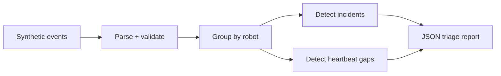

# Autonomy Log Triage

A small, deterministic Python tool for turning synthetic robot event logs into an incident-first report. It demonstrates the kind of observability workflow useful around ROS2 autonomy systems without publishing or reproducing employer code.

> All events in this repository are synthetic. This project is an independent portfolio demonstration and is not affiliated with any employer.

## What it does

- Parses JSON Lines robot events into typed records.
- Surfaces communication, localization, planning, recovery, and battery incidents.
- Detects heartbeat gaps per robot.
- Produces stable JSON for dashboards, CI artifacts, or incident review.
- Uses only the Python standard library.



## Quick start

```bash
python -m venv .venv
source .venv/bin/activate
python -m pip install -e .
autonomy-triage examples/synthetic_events.jsonl
```

Run the tests:

```bash
python -m unittest discover -s tests -v
```

## Event format

```json
{"timestamp":"2026-01-01T12:00:12Z","robot_id":"robot-07","event":"planning_stall","details":{"duration_ms":840}}
```

The input contract is intentionally transport-neutral, so a separate adapter can map ROS2 bag, MCAP, database, or telemetry-stream records into this shape.

## Design notes

- Detection rules are explicit and auditable.
- Parsing fails with a line-numbered error instead of silently dropping malformed events.
- The core analyzer is separated from the CLI for testing and reuse.
- The sample avoids proprietary schemas, maps, missions, and facility information.
