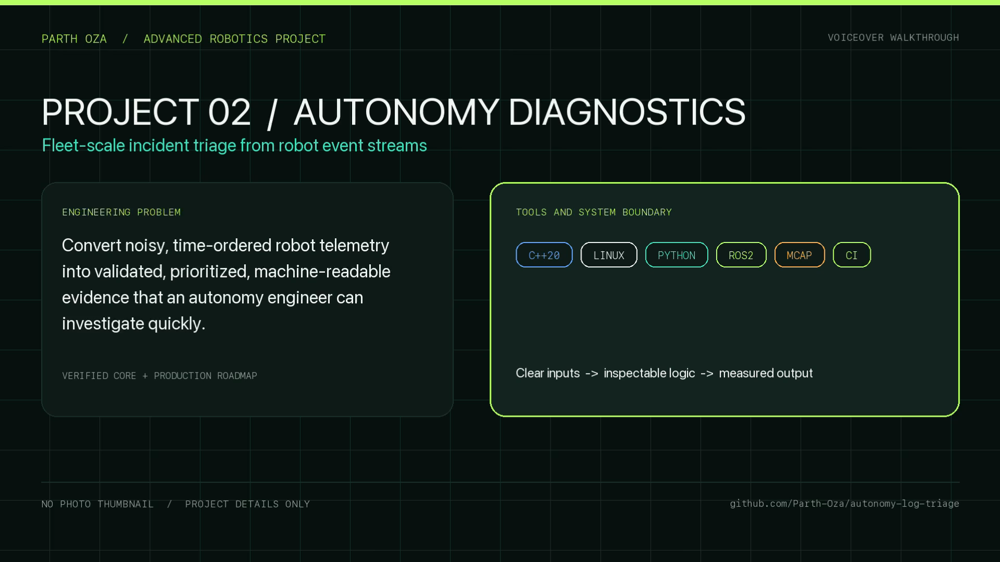
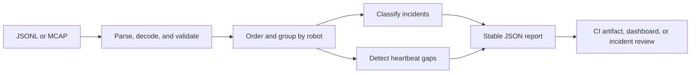

# Autonomy Log Triage

[](https://github.com/Parth-Oza/autonomy-log-triage/actions/workflows/test.yml)
[](https://www.python.org/)
[](LICENSE)

A deterministic Python reference for turning robot event streams into incident-first diagnostic reports. It demonstrates production-minded observability patterns useful around ROS2 autonomy systems: streaming MCAP ingestion, strict parsing, explicit failure classification, heartbeat-gap detection, stable JSON output, and repeatable tests.

> All events are synthetic. This independent portfolio project is not affiliated with any employer and contains no employer code, schemas, maps, missions, facility details, or operational data.

## Technical walkthrough

[](docs/media/autonomy-diagnostics-walkthrough.mp4)

The four-minute English walkthrough explains the event contract, validation path, deterministic ordering, incident rules, heartbeat-gap calculation, stable output, and production extension boundaries. See [Evidence](docs/EVIDENCE.md) for the exact verification record and limitations.

## Capabilities

- Parses JSON Lines events into validated, typed records.
- Streams JSON and ROS 2 CDR event channels from MCAP recordings.
- Classifies communication, localization, planning, recovery, and battery incidents.
- Detects per-robot heartbeat discontinuities using a configurable threshold.
- Orders incidents deterministically and emits machine-readable JSON.
- Separates analysis from the CLI for reuse in tests, services, or adapters.
- Preserves MCAP topic, schema, log-time, and publish-time metadata.



## Quick start

```bash
python -m venv .venv
source .venv/bin/activate
python -m pip install -e .
autonomy-triage examples/synthetic_events.jsonl
```

Change the heartbeat threshold:

```bash
autonomy-triage examples/synthetic_events.jsonl --heartbeat-gap 20
```

Process a ROS 2 MCAP recording and select one or more event topics:

```bash
autonomy-triage recording.mcap --topic /autonomy/events
autonomy-triage recording.mcap --topic /robot_01/events --topic /robot_02/events
```

The `.mcap` extension is detected automatically. Use `--input-format mcap` when a recording has another extension.

Run the tests:

```bash
python -m unittest discover -s tests -v
```

## Input contract

Each non-empty line must be a JSON object with an ISO-8601 timestamp, robot identifier, event name, and optional details object.

```json
{"timestamp":"2026-01-01T12:00:12Z","robot_id":"robot-07","event":"planning_stall","details":{"duration_ms":840}}
```

The JSONL contract is transport-neutral. MCAP channels may use JSON encoding or ROS 2 CDR with a `ros2msg` schema. Their decoded messages must expose:

- `robot_id`: non-empty string
- `event`: non-empty string
- `details`: optional object for JSON channels
- `details_json`: optional JSON object string for ROS 2 messages

The event timestamp comes from the MCAP log time. Exact nanosecond log/publish times, topic, and schema are retained under `details.mcap`. The key `mcap` is reserved so source metadata cannot be overwritten by a payload.

The MCAP path is streamed in file order with CRC validation and no whole-recording sort. The analyzer uses a one-pass ordered mode and rejects per-robot timestamp regressions, making ordering assumptions explicit rather than silently generating incorrect gaps.

## Output contract

The CLI returns a stable JSON document containing:

- `summary`: total events, robots, incidents, and heartbeat gaps.
- `event_counts`: descending event-frequency map.
- `incidents`: robot, timestamp, type, severity, and details.
- `heartbeat_gaps`: robot, preceding timestamp, and gap duration.

## Project layout

```text
src/autonomy_log_triage/analyzer.py  Event model, JSONL parser, analysis rules
src/autonomy_log_triage/mcap_adapter.py  Streaming JSON/ROS 2 MCAP adapter
src/autonomy_log_triage/cli.py       Command-line interface
examples/synthetic_events.jsonl      Safe demonstration data
tests/test_analyzer.py               Regression and validation tests
tests/test_mcap_adapter.py            Real MCAP round-trip and failure tests
docs/ARCHITECTURE.md                 Design boundaries and extension points
```

## Engineering principles

- Fail loudly on malformed input with a line-numbered error.
- Keep detection rules explicit, reviewable, and testable.
- Produce deterministic results suitable for CI and incident comparison.
- Keep proprietary integrations outside the public analysis core.

See [Architecture](docs/ARCHITECTURE.md), [Evidence](docs/EVIDENCE.md), [Contributing](CONTRIBUTING.md), and [Security](SECURITY.md).

## Contact

For professional opportunities and technical discussions: [ozaparthu055@gmail.com](mailto:ozaparthu055@gmail.com) · [Portfolio](https://parthoza.net) · [LinkedIn](https://www.linkedin.com/in/oza-parth)
